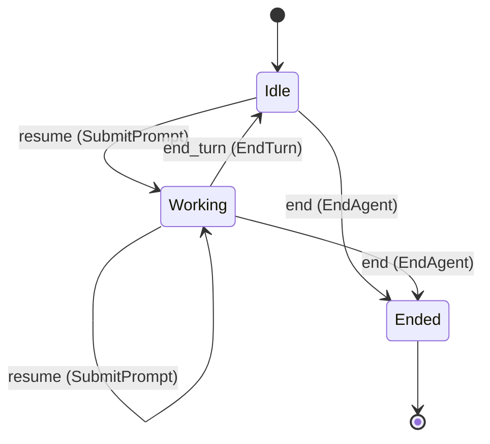
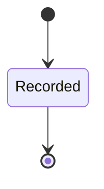
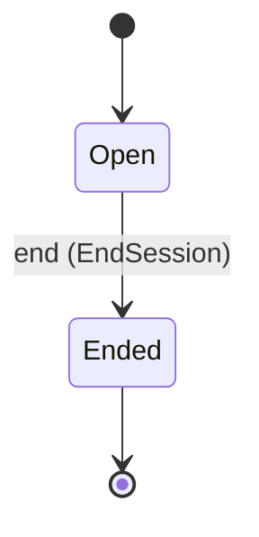
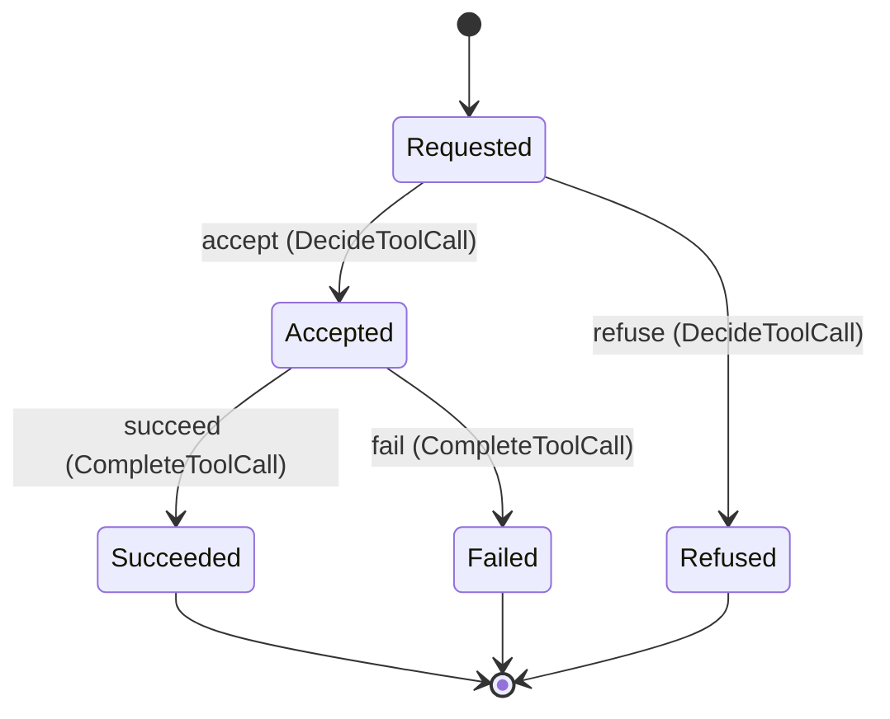

<!--
generated from agentspec v1
contract digest slice-sha256/2:88219dd094ecd6c9e9625d47fea9cbac6349753c48513fd964b7d7b7a6e2bb59
do not edit: regenerate with `ess generate`
-->

# Session

An agent session of any harness, as actors issuing commands. An adapter lifts a vendor transcript into these commands; replaying them yields the events and the state the KPIs read. Content is never held: a prompt, a tool input or a tool output is a digest and a length.

`agentspec.session` is one of agentspec's bounded contexts. [Back to the index](../index.md).

## Types

### `AgentId`

`agentspec.session.AgentId` wraps `String` and is not interchangeable with one: the whole value of naming it separately is the crossings the model then refuses.

### `AgentRole`

`agentspec.session.AgentRole` is one of `Main`, `SubAgent` and `SideCall`.

### `Attribution`

`agentspec.session.Attribution` is one of `Known`, `Inferred` and `Unknown`.

### `Content`

`agentspec.session.Content` is a record of two fields:

- `digest` — `String`
- `bytes` — `Integer`

### `Decider`

`agentspec.session.Decider` is one of `PermissionMode`, `Classifier`, `Hook`, `Human`, `SafetyCheck`, `Rule` and `NotRecorded`.

### `Decision`

`agentspec.session.Decision` is one of `Accept` and `Refuse`.

### `ExposureChannel`

`agentspec.session.ExposureChannel` is one of `Prompt`, `ToolInput`, `ToolOutput` and `AgentText`.

### `ExposureClass`

`agentspec.session.ExposureClass` is one of `Secret` and `PersonalData`.

### `ExposureId`

`agentspec.session.ExposureId` wraps `String` and is not interchangeable with one: the whole value of naming it separately is the crossings the model then refuses.

### `Harness`

`agentspec.session.Harness` is one of `ClaudeCode`, `Codex` and `Other`.

### `IncompleteReason`

`agentspec.session.IncompleteReason` is one of `client_disconnected`, `upstream_cut`, `wire_error` and `refused`.

### `PromptAuthor`

`agentspec.session.PromptAuthor` is one of `Human`, `Delegate`, `PeerSession`, `ParentAgent`, `Harness` and `Hook`.

### `PromptClass`

`agentspec.session.PromptClass` is one of `Task`, `Correction`, `Approval`, `Question`, `Continue` and `Unknown`.

### `SessionId`

`agentspec.session.SessionId` wraps `String` and is not interchangeable with one: the whole value of naming it separately is the crossings the model then refuses.

### `Source`

`agentspec.session.Source` is one of `Disk` and `Wire`.

### `ToolCallId`

`agentspec.session.ToolCallId` wraps `String` and is not interchangeable with one: the whole value of naming it separately is the crossings the model then refuses.

### `ToolCategory`

`agentspec.session.ToolCategory` is one of `Read`, `Search`, `Edit`, `Execute`, `Network`, `Spawn`, `Message`, `Plan` and `Other`.

### `Usage`

`agentspec.session.Usage` is a record of five fields:

- `uncached_input` — `Integer`
- `cache_read` — `Integer`
- `cache_write_5m` — `Integer`
- `cache_write_1h` — `Integer`
- `output` — `Integer`

### `Verdict`

`agentspec.session.Verdict` is one of `Ok`, `Gap` and `Unk`.

## Entities

An entity is what this context is about: something with an identity that outlives any one request, a shape, and a lifecycle. The lifecycle is exhaustive — a move that is not drawn below is a move this specification does not permit, and that is the only way it says so. Every move is labelled with the command that takes it, because a move nothing can trigger is refused rather than drawn.

### `Agent`

`agentspec.session.Agent`.

An instance is identified by `agent_id`, a `agentspec.session.AgentId`. The name is part of the model and not a convention: a view projects the identity under that name, so a projection inventing its own would disagree with the view.

It holds:

- `session_id` — `agentspec.session.SessionId`
- `parent_agent_id` — `Optional<agentspec.session.AgentId>`, which may be absent
- `role` — `agentspec.session.AgentRole`
- `model` — `Optional<String>`, which may be absent
- `context_tokens` — `Integer`

It owns any number of [`ToolCall`](#toolcall), as `tool_calls`, carried by `ToolCall.agent_id`. It references at most one [`Agent`](#agent), as `parent`, carried by `Agent.parent_agent_id`. It owns any number of [`Exposure`](#exposure), as `exposures`, carried by `Exposure.agent_id`. Its `session_id` is what [`Session`](#session) owns it by, as `agents`.

No invariant is declared, so nothing here constrains an instance at rest.

Its state is a `agentspec.session.Agent.State`, one of `Ended`, `Idle` and `Working`. That enum is synthesised from the lifecycle rather than declared beside it, so the states a view's filter compares and the states drawn below cannot disagree.

An instance is created in `Idle`. `Ended` is terminal, so an instance may rest there forever. That is declared rather than inferred from having no way out: an entity that cannot leave a state is either finished or stuck, and only its author knows which.

Each move is taken by a declared command outcome, and a move nothing takes is refused as `missing_causation` rather than left as a state change nobody can trigger:

- `resume` — taken by `agentspec.session.SubmitPrompt` on its `submitted` outcome
- `end_turn` — taken by `agentspec.session.EndTurn` on its `ended` outcome
- `end` — taken by `agentspec.session.EndAgent` on its `ended` outcome

An instance is brought into existence by `agentspec.session.StartAgent` on its `started` outcome.

Illegal transitions are illegal by absence: no rule forbids them, there is simply no arrow, because a rule would be a second place for the same truth to live. A diagram cannot show an absence, so the pairs it does not connect are listed here, derived from the same transitions — anything named below is a move this specification does not permit.

- `Ended` may not become `Idle`
- `Ended` may not become `Working`

One view projects it: [`Agents`](#agents).

### `Exposure`

`agentspec.session.Exposure`.

An instance is identified by `exposure_id`, a `agentspec.session.ExposureId`. The name is part of the model and not a convention: a view projects the identity under that name, so a projection inventing its own would disagree with the view.

It holds:

- `agent_id` — `agentspec.session.AgentId`
- `channel` — `agentspec.session.ExposureChannel`
- `class` — `agentspec.session.ExposureClass`
- `kind` — `String`
- `alias` — `String`
- `verdict` — `agentspec.session.Verdict`
- `tool_call_id` — `Optional<agentspec.session.ToolCallId>`, which may be absent

It references at most one [`ToolCall`](#toolcall), as `tool_call`, carried by `Exposure.tool_call_id`. Its `agent_id` is what [`Agent`](#agent) owns it by, as `exposures`.

No invariant is declared, so nothing here constrains an instance at rest.

Its state is a `agentspec.session.Exposure.State`, one of `Recorded`. That enum is synthesised from the lifecycle rather than declared beside it, so the states a view's filter compares and the states drawn below cannot disagree.

An instance is created in `Recorded`. `Recorded` is terminal, so an instance may rest there forever. That is declared rather than inferred from having no way out: an entity that cannot leave a state is either finished or stuck, and only its author knows which.

It declares no moves, so nothing changes its state once it exists.

It has one state, so there is no move to permit or to forbid.

One view projects it: [`Exposures`](#exposures).

### `Session`

`agentspec.session.Session`.

An instance is identified by `session_id`, a `agentspec.session.SessionId`. The name is part of the model and not a convention: a view projects the identity under that name, so a projection inventing its own would disagree with the view.

It holds:

- `harness` — `agentspec.session.Harness`
- `opened_at` — `Timestamp`

It owns any number of [`Agent`](#agent), as `agents`, carried by `Agent.session_id`.

No invariant is declared, so nothing here constrains an instance at rest.

Its state is a `agentspec.session.Session.State`, one of `Ended` and `Open`. That enum is synthesised from the lifecycle rather than declared beside it, so the states a view's filter compares and the states drawn below cannot disagree.

An instance is created in `Open`. `Ended` is terminal, so an instance may rest there forever. That is declared rather than inferred from having no way out: an entity that cannot leave a state is either finished or stuck, and only its author knows which.

Each move is taken by a declared command outcome, and a move nothing takes is refused as `missing_causation` rather than left as a state change nobody can trigger:

- `end` — taken by `agentspec.session.EndSession` on its `ended` outcome

An instance is brought into existence by `agentspec.session.OpenSession` on its `opened` outcome.

Illegal transitions are illegal by absence: no rule forbids them, there is simply no arrow, because a rule would be a second place for the same truth to live. A diagram cannot show an absence, so the pairs it does not connect are listed here, derived from the same transitions — anything named below is a move this specification does not permit.

- `Ended` may not become `Open`

One view projects it: [`Sessions`](#sessions).

### `ToolCall`

`agentspec.session.ToolCall`.

An instance is identified by `tool_call_id`, a `agentspec.session.ToolCallId`. The name is part of the model and not a convention: a view projects the identity under that name, so a projection inventing its own would disagree with the view.

It holds:

- `agent_id` — `agentspec.session.AgentId`
- `tool` — `String`
- `category` — `agentspec.session.ToolCategory`

Its `agent_id` is what [`Agent`](#agent) owns it by, as `tool_calls`.

No invariant is declared, so nothing here constrains an instance at rest.

Its state is a `agentspec.session.ToolCall.State`, one of `Accepted`, `Failed`, `Refused`, `Requested` and `Succeeded`. That enum is synthesised from the lifecycle rather than declared beside it, so the states a view's filter compares and the states drawn below cannot disagree.

An instance is created in `Requested`. `Failed`, `Refused` and `Succeeded` are terminal, so an instance may rest there forever. That is declared rather than inferred from having no way out: an entity that cannot leave a state is either finished or stuck, and only its author knows which.

Each move is taken by a declared command outcome, and a move nothing takes is refused as `missing_causation` rather than left as a state change nobody can trigger:

- `accept` — taken by `agentspec.session.DecideToolCall` on its `accepted` outcome
- `refuse` — taken by `agentspec.session.DecideToolCall` on its `refused` outcome
- `succeed` — taken by `agentspec.session.CompleteToolCall` on its `succeeded` outcome
- `fail` — taken by `agentspec.session.CompleteToolCall` on its `failed` outcome

An instance is brought into existence by `agentspec.session.RequestToolCall` on its `requested` outcome.

Illegal transitions are illegal by absence: no rule forbids them, there is simply no arrow, because a rule would be a second place for the same truth to live. A diagram cannot show an absence, so the pairs it does not connect are listed here, derived from the same transitions — anything named below is a move this specification does not permit.

- `Accepted` may not become `Refused`
- `Accepted` may not become `Requested`
- `Failed` may not become `Accepted`
- `Failed` may not become `Refused`
- `Failed` may not become `Requested`
- `Failed` may not become `Succeeded`
- `Refused` may not become `Accepted`
- `Refused` may not become `Failed`
- `Refused` may not become `Requested`
- `Refused` may not become `Succeeded`
- `Requested` may not become `Failed`
- `Requested` may not become `Succeeded`
- `Succeeded` may not become `Accepted`
- `Succeeded` may not become `Failed`
- `Succeeded` may not become `Refused`
- `Succeeded` may not become `Requested`

One view projects it: [`ToolCalls`](#toolcalls).

## Views

A view is what the outside world is promised it can observe. Each one says which instances it contains and how soon it reflects a command that has already returned, because "you can read this" without "how soon" is the promise every flaky suite is built on.

### `Agents`

`agentspec.session.Agents`, shown to a person as "Agents" and called `agents` on the wire.

It reads [`Agent`](#agent).

It contains every instance of that entity: no filter narrows it, which is a decision somebody made and not a line somebody omitted.

It exposes:

- `agent_id` — `agentspec.session.AgentId`
- `session_id` — `agentspec.session.SessionId`
- `parent_agent_id` — `Optional<agentspec.session.AgentId>`, which may be absent
- `role` — `agentspec.session.AgentRole`
- `model` — `Optional<String>`, which may be absent
- `context_tokens` — `Integer`
- `state` — `agentspec.session.Agent.State`

It declares no order, so the rows come back in whatever order the implementation has, and two reads may disagree.

**Read-your-writes**: it is current the moment the command that changed it returns. A caller that has just created an invoice and cannot see it in here has been told a lie about what it did.

A generated scenario asserts it once, immediately after the command: a view promising this and not keeping the promise has to fail the suite rather than be retried until it passes.

### `Exposures`

`agentspec.session.Exposures`, shown to a person as "Exposures" and called `exposures` on the wire.

It reads [`Exposure`](#exposure).

It contains every instance of that entity: no filter narrows it, which is a decision somebody made and not a line somebody omitted.

It exposes:

- `exposure_id` — `agentspec.session.ExposureId`
- `agent_id` — `agentspec.session.AgentId`
- `channel` — `agentspec.session.ExposureChannel`
- `class` — `agentspec.session.ExposureClass`
- `kind` — `String`
- `verdict` — `agentspec.session.Verdict`
- `state` — `agentspec.session.Exposure.State`

It declares no order, so the rows come back in whatever order the implementation has, and two reads may disagree.

**Read-your-writes**: it is current the moment the command that changed it returns. A caller that has just created an invoice and cannot see it in here has been told a lie about what it did.

A generated scenario asserts it once, immediately after the command: a view promising this and not keeping the promise has to fail the suite rather than be retried until it passes.

### `Sessions`

`agentspec.session.Sessions`, shown to a person as "Sessions" and called `sessions` on the wire.

It reads [`Session`](#session).

It contains every instance of that entity: no filter narrows it, which is a decision somebody made and not a line somebody omitted.

It exposes:

- `session_id` — `agentspec.session.SessionId`
- `harness` — `agentspec.session.Harness`
- `opened_at` — `Timestamp`
- `state` — `agentspec.session.Session.State`

It declares no order, so the rows come back in whatever order the implementation has, and two reads may disagree.

**Read-your-writes**: it is current the moment the command that changed it returns. A caller that has just created an invoice and cannot see it in here has been told a lie about what it did.

A generated scenario asserts it once, immediately after the command: a view promising this and not keeping the promise has to fail the suite rather than be retried until it passes.

### `ToolCalls`

`agentspec.session.ToolCalls`, shown to a person as "Tool calls" and called `tool-calls` on the wire.

It reads [`ToolCall`](#toolcall).

It contains every instance of that entity: no filter narrows it, which is a decision somebody made and not a line somebody omitted.

It exposes:

- `tool_call_id` — `agentspec.session.ToolCallId`
- `agent_id` — `agentspec.session.AgentId`
- `tool` — `String`
- `category` — `agentspec.session.ToolCategory`
- `state` — `agentspec.session.ToolCall.State`

It declares no order, so the rows come back in whatever order the implementation has, and two reads may disagree.

**Read-your-writes**: it is current the moment the command that changed it returns. A caller that has just created an invoice and cannot see it in here has been told a lie about what it did.

A generated scenario asserts it once, immediately after the command: a view promising this and not keeping the promise has to fail the suite rather than be retried until it passes.

## Commands

### `CompactContext`

`agentspec.session.CompactContext`, shown to a person as "Compact the context" and called `compact-context` on the wire.

It takes:

- `agent_id` — `agentspec.session.AgentId`
- `context_tokens_before` — `Integer`
- `at` — `Timestamp`

It has two outcomes.

**`compacted`** — The context was replaced by a summary; the next model turn writes the cache again. The default branch, taken when no other outcome's condition matched. It changes a `agentspec.session.Agent` without moving it along its lifecycle. The instance is the one named by the input field `agent_id`. It emits `agentspec.session.ContextCompacted`. It sets `context_tokens` from `"0"`. A test reaches it by constructing an input that satisfies no other outcome's condition.

**`no-such-agent`** — Taken when the identity the command names is one no record carries, before any other answer for it. No entity in this specification changes. It reports `agentspec.session.UnknownAgent`, carrying `agent_id`. It emits nothing. A test reaches it by sending an identity no record carries, arranging nothing.

### `CompleteToolCall`

`agentspec.session.CompleteToolCall`, shown to a person as "Complete a tool call" and called `complete-tool-call` on the wire.

It takes:

- `tool_call_id` — `agentspec.session.ToolCallId`
- `ok` — `Boolean`
- `output` — `agentspec.session.Content`
- `at` — `Timestamp`

It has three outcomes.

**`succeeded`** — The tool returned a result. Taken when `ok == true` holds of the input. It moves a `agentspec.session.ToolCall` from `Accepted` to `Succeeded`, along the declared move `succeed`. The instance is the one named by the input field `tool_call_id`. It emits `agentspec.session.ToolCallCompleted`. A test reaches it by constructing an input that satisfies that condition.

**`failed`** — The tool returned an error. The default branch, taken when no other outcome's condition matched. It moves a `agentspec.session.ToolCall` from `Accepted` to `Failed`, along the declared move `fail`. The instance is the one named by the input field `tool_call_id`. It emits `agentspec.session.ToolCallCompleted`. A test reaches it by constructing an input that satisfies no other outcome's condition.

**`wrong-state`** — The tool call was not running. Taken when the subject is resting in a state none of this command's moves start from — a `agentspec.session.ToolCall` in `Failed`, `Refused`, `Requested` and `Succeeded`, which is what is left of the lifecycle once this command's own moves are taken away. The document lists none of it. No entity in this specification changes. It reports `agentspec.session.ToolCallStateConflict`, carrying `state`. It emits nothing. A test reaches it by driving an instance into one of those states and then issuing the command, because no input selects this branch.

### `DecideToolCall`

`agentspec.session.DecideToolCall`, shown to a person as "Decide a tool call" and called `decide-tool-call` on the wire.

It takes:

- `tool_call_id` — `agentspec.session.ToolCallId`
- `decision` — `agentspec.session.Decision`
- `decider` — `agentspec.session.Decider`
- `reason` — `Optional<String>`, which may be absent
- `at` — `Timestamp`

It has three outcomes.

**`accepted`** — The tool runs. Taken when `decision == Accept` holds of the input. It moves a `agentspec.session.ToolCall` from `Requested` to `Accepted`, along the declared move `accept`. The instance is the one named by the input field `tool_call_id`. It emits `agentspec.session.ToolCallDecided`. A test reaches it by constructing an input that satisfies that condition.

**`refused`** — The tool does not run; the agent gets the refusal as its result. The default branch, taken when no other outcome's condition matched. It moves a `agentspec.session.ToolCall` from `Requested` to `Refused`, along the declared move `refuse`. The instance is the one named by the input field `tool_call_id`. It emits `agentspec.session.ToolCallDecided`. A test reaches it by constructing an input that satisfies no other outcome's condition.

**`wrong-state`** — The tool call was already decided. Taken when the subject is resting in a state none of this command's moves start from — a `agentspec.session.ToolCall` in `Accepted`, `Failed`, `Refused` and `Succeeded`, which is what is left of the lifecycle once this command's own moves are taken away. The document lists none of it. No entity in this specification changes. It reports `agentspec.session.ToolCallStateConflict`, carrying `state`. It emits nothing. A test reaches it by driving an instance into one of those states and then issuing the command, because no input selects this branch.

### `EndAgent`

`agentspec.session.EndAgent`, shown to a person as "End an agent" and called `end-agent` on the wire.

It takes:

- `agent_id` — `agentspec.session.AgentId`
- `at` — `Timestamp`

It has two outcomes.

**`ended`** — The agent will take no further prompt. The default branch, taken when no other outcome's condition matched. It moves a `agentspec.session.Agent` from `Idle` and `Working` to `Ended`, along the declared move `end`. The instance is the one named by the input field `agent_id`. It emits `agentspec.session.AgentEnded`. A test reaches it by constructing an input that satisfies no other outcome's condition.

**`wrong-state`** — The agent had already ended. Taken when the subject is resting in a state none of this command's moves start from — a `agentspec.session.Agent` in `Ended`, which is what is left of the lifecycle once this command's own moves are taken away. The document lists none of it. No entity in this specification changes. It reports `agentspec.session.AgentStateConflict`, carrying `state`. It emits nothing. A test reaches it by driving an instance into one of those states and then issuing the command, because no input selects this branch.

### `EndSession`

`agentspec.session.EndSession`, shown to a person as "End a session" and called `end-session` on the wire.

It takes:

- `session_id` — `agentspec.session.SessionId`
- `at` — `Timestamp`

It has two outcomes.

**`ended`** — The session has ended; the transcript holds no later record. The default branch, taken when no other outcome's condition matched. It moves a `agentspec.session.Session` from `Open` to `Ended`, along the declared move `end`. The instance is the one named by the input field `session_id`. It emits `agentspec.session.SessionEnded`. A test reaches it by constructing an input that satisfies no other outcome's condition.

**`wrong-state`** — The session had already ended. Taken when the subject is resting in a state none of this command's moves start from — a `agentspec.session.Session` in `Ended`, which is what is left of the lifecycle once this command's own moves are taken away. The document lists none of it. No entity in this specification changes. It reports `agentspec.session.SessionStateConflict`, carrying `state`. It emits nothing. A test reaches it by driving an instance into one of those states and then issuing the command, because no input selects this branch.

### `EndTurn`

`agentspec.session.EndTurn`, shown to a person as "End a turn" and called `end-turn` on the wire.

It takes:

- `agent_id` — `agentspec.session.AgentId`
- `at` — `Timestamp`

It has two outcomes.

**`ended`** — The agent is Idle and waits for its next prompt. The default branch, taken when no other outcome's condition matched. It moves a `agentspec.session.Agent` from `Working` to `Idle`, along the declared move `end_turn`. The instance is the one named by the input field `agent_id`. It emits `agentspec.session.TurnEnded`. A test reaches it by constructing an input that satisfies no other outcome's condition.

**`wrong-state`** — The agent was not Working. Taken when the subject is resting in a state none of this command's moves start from — a `agentspec.session.Agent` in `Ended` and `Idle`, which is what is left of the lifecycle once this command's own moves are taken away. The document lists none of it. No entity in this specification changes. It reports `agentspec.session.AgentStateConflict`, carrying `state`. It emits nothing. A test reaches it by driving an instance into one of those states and then issuing the command, because no input selects this branch.

### `OpenSession`

`agentspec.session.OpenSession`, shown to a person as "Open a session" and called `open-session` on the wire.

It takes:

- `session_id` — `agentspec.session.SessionId`
- `harness` — `agentspec.session.Harness`
- `source` — `Optional<agentspec.session.Source>`, which may be absent
- `session_hash` — `Optional<String>`, which may be absent
- `at` — `Timestamp`

It has one outcome.

**`opened`** — The session exists and holds no agent yet. The default branch, taken when no other outcome's condition matched. It creates a `agentspec.session.Session`, which starts in `Open`. The new instance's identity is published as `session_id` on `agentspec.session.SessionOpened`. It emits `agentspec.session.SessionOpened`. It sets `harness` from `input.harness` and `opened_at` from `input.at`. A test reaches it by constructing an input that satisfies no other outcome's condition.

### `RecordExposure`

`agentspec.session.RecordExposure`, shown to a person as "Record an exposure" and called `record-exposure` on the wire.

It takes:

- `exposure_id` — `agentspec.session.ExposureId`
- `agent_id` — `agentspec.session.AgentId`
- `channel` — `agentspec.session.ExposureChannel`
- `class` — `agentspec.session.ExposureClass`
- `kind` — `String`
- `alias` — `String`
- `verdict` — `agentspec.session.Verdict`
- `tool_call_id` — `Optional<agentspec.session.ToolCallId>`, which may be absent
- `at` — `Timestamp`

It has one outcome.

**`recorded`** — The exposure is on record under its alias; the value is not. The default branch, taken when no other outcome's condition matched. It creates a `agentspec.session.Exposure`, which starts in `Recorded`. The new instance's identity is published as `exposure_id` on `agentspec.session.ExposureDetected`. It emits `agentspec.session.ExposureDetected`. It sets `agent_id` from `input.agent_id`, `channel` from `input.channel`, `class` from `input.class`, `kind` from `input.kind`, `alias` from `input.alias`, `verdict` from `input.verdict` and `tool_call_id` from `input.tool_call_id`. A test reaches it by constructing an input that satisfies no other outcome's condition.

### `RecordModelTurn`

`agentspec.session.RecordModelTurn`, shown to a person as "Record a model turn" and called `record-model-turn` on the wire.

It takes:

- `agent_id` — `agentspec.session.AgentId`
- `model` — `String`
- `usage` — `agentspec.session.Usage`
- `context_tokens` — `Integer`
- `message_id` — `Optional<String>`, which may be absent
- `call_id` — `Optional<String>`, which may be absent
- `route` — `Optional<String>`, which may be absent
- `upstream` — `Optional<String>`, which may be absent
- `attempts` — `Optional<Integer>`, which may be absent
- `queue_wait_ms` — `Optional<Integer>`, which may be absent
- `ttft_ms` — `Optional<Integer>`, which may be absent
- `declared_cost_microdollars` — `Optional<Integer>`, which may be absent
- `incomplete` — `Optional<agentspec.session.IncompleteReason>`, which may be absent
- `at` — `Timestamp`

It has two outcomes.

**`recorded`** — The agent's model and context size are those of this message. The default branch, taken when no other outcome's condition matched. It changes a `agentspec.session.Agent` without moving it along its lifecycle. The instance is the one named by the input field `agent_id`. It emits `agentspec.session.ModelTurnRecorded`. It sets `model` from `input.model` and `context_tokens` from `input.context_tokens`. A test reaches it by constructing an input that satisfies no other outcome's condition.

**`no-such-agent`** — Taken when the identity the command names is one no record carries, before any other answer for it. No entity in this specification changes. It reports `agentspec.session.UnknownAgent`, carrying `agent_id`. It emits nothing. A test reaches it by sending an identity no record carries, arranging nothing.

### `RequestToolCall`

`agentspec.session.RequestToolCall`, shown to a person as "Request a tool call" and called `request-tool-call` on the wire.

It takes:

- `tool_call_id` — `agentspec.session.ToolCallId`
- `agent_id` — `agentspec.session.AgentId`
- `tool` — `String`
- `category` — `agentspec.session.ToolCategory`
- `input` — `agentspec.session.Content`
- `cwd` — `Optional<String>`, which may be absent
- `background` — `Boolean`
- `at` — `Timestamp`

It has one outcome.

**`requested`** — The tool call waits for a decision. The default branch, taken when no other outcome's condition matched. It creates a `agentspec.session.ToolCall`, which starts in `Requested`. The new instance's identity is published as `tool_call_id` on `agentspec.session.ToolCallRequested`. It emits `agentspec.session.ToolCallRequested`. It sets `agent_id` from `input.agent_id`, `tool` from `input.tool` and `category` from `input.category`. A test reaches it by constructing an input that satisfies no other outcome's condition.

### `StartAgent`

`agentspec.session.StartAgent`, shown to a person as "Start an agent" and called `start-agent` on the wire.

It takes:

- `agent_id` — `agentspec.session.AgentId`
- `session_id` — `agentspec.session.SessionId`
- `parent_agent_id` — `Optional<agentspec.session.AgentId>`, which may be absent
- `role` — `agentspec.session.AgentRole`
- `spawned_by` — `Optional<agentspec.session.ToolCallId>`, which may be absent
- `at` — `Timestamp`

It has one outcome.

**`started`** — The agent exists and is Idle until its first prompt. The default branch, taken when no other outcome's condition matched. It creates a `agentspec.session.Agent`, which starts in `Idle`. The new instance's identity is published as `agent_id` on `agentspec.session.AgentStarted`. It emits `agentspec.session.AgentStarted`. It sets `session_id` from `input.session_id`, `parent_agent_id` from `input.parent_agent_id`, `role` from `input.role` and `context_tokens` from `"0"`. A test reaches it by constructing an input that satisfies no other outcome's condition.

### `SubmitPrompt`

`agentspec.session.SubmitPrompt`, shown to a person as "Submit a prompt" and called `submit-prompt` on the wire.

It takes:

- `agent_id` — `agentspec.session.AgentId`
- `author` — `agentspec.session.PromptAuthor`
- `attribution` — `agentspec.session.Attribution`
- `class` — `agentspec.session.PromptClass`
- `content` — `agentspec.session.Content`
- `at` — `Timestamp`

It has two outcomes.

**`submitted`** — The agent is Working on the prompt. The default branch, taken when no other outcome's condition matched. It moves a `agentspec.session.Agent` from `Idle` and `Working` to `Working`, along the declared move `resume`. The instance is the one named by the input field `agent_id`. It emits `agentspec.session.PromptSubmitted`. A test reaches it by constructing an input that satisfies no other outcome's condition.

**`wrong-state`** — The agent had ended, so the prompt reached nobody. Taken when the subject is resting in a state none of this command's moves start from — a `agentspec.session.Agent` in `Ended`, which is what is left of the lifecycle once this command's own moves are taken away. The document lists none of it. No entity in this specification changes. It reports `agentspec.session.AgentStateConflict`, carrying `state`. It emits nothing. A test reaches it by driving an instance into one of those states and then issuing the command, because no input selects this branch.

## Events

### `AgentEnded`

`agentspec.session.AgentEnded`.

It carries:

- `agent_id` — `agentspec.session.AgentId`
- `at` — `Timestamp`

Emitted by `agentspec.session.EndAgent` on its `ended` outcome.

Nothing in this system reacts to it.

### `AgentStarted`

`agentspec.session.AgentStarted`.

It carries:

- `agent_id` — `agentspec.session.AgentId`
- `session_id` — `agentspec.session.SessionId`
- `parent_agent_id` — `Optional<agentspec.session.AgentId>`, which may be absent
- `role` — `agentspec.session.AgentRole`
- `spawned_by` — `Optional<agentspec.session.ToolCallId>`, which may be absent
- `at` — `Timestamp`

Emitted by `agentspec.session.StartAgent` on its `started` outcome.

Nothing in this system reacts to it.

### `ContextCompacted`

`agentspec.session.ContextCompacted`.

It carries:

- `agent_id` — `agentspec.session.AgentId`
- `context_tokens_before` — `Integer`
- `at` — `Timestamp`

Emitted by `agentspec.session.CompactContext` on its `compacted` outcome.

Nothing in this system reacts to it.

### `ExposureDetected`

`agentspec.session.ExposureDetected`.

It carries:

- `exposure_id` — `agentspec.session.ExposureId`
- `agent_id` — `agentspec.session.AgentId`
- `channel` — `agentspec.session.ExposureChannel`
- `class` — `agentspec.session.ExposureClass`
- `kind` — `String`
- `alias` — `String`
- `verdict` — `agentspec.session.Verdict`
- `tool_call_id` — `Optional<agentspec.session.ToolCallId>`, which may be absent
- `at` — `Timestamp`

Emitted by `agentspec.session.RecordExposure` on its `recorded` outcome.

Nothing in this system reacts to it.

### `ModelTurnRecorded`

`agentspec.session.ModelTurnRecorded`.

It carries:

- `agent_id` — `agentspec.session.AgentId`
- `model` — `String`
- `usage` — `agentspec.session.Usage`
- `context_tokens` — `Integer`
- `message_id` — `Optional<String>`, which may be absent
- `call_id` — `Optional<String>`, which may be absent
- `route` — `Optional<String>`, which may be absent
- `upstream` — `Optional<String>`, which may be absent
- `attempts` — `Optional<Integer>`, which may be absent
- `queue_wait_ms` — `Optional<Integer>`, which may be absent
- `ttft_ms` — `Optional<Integer>`, which may be absent
- `declared_cost_microdollars` — `Optional<Integer>`, which may be absent
- `incomplete` — `Optional<agentspec.session.IncompleteReason>`, which may be absent
- `at` — `Timestamp`

Emitted by `agentspec.session.RecordModelTurn` on its `recorded` outcome.

Nothing in this system reacts to it.

### `PromptSubmitted`

`agentspec.session.PromptSubmitted`.

It carries:

- `agent_id` — `agentspec.session.AgentId`
- `author` — `agentspec.session.PromptAuthor`
- `attribution` — `agentspec.session.Attribution`
- `class` — `agentspec.session.PromptClass`
- `content` — `agentspec.session.Content`
- `at` — `Timestamp`

Emitted by `agentspec.session.SubmitPrompt` on its `submitted` outcome.

Nothing in this system reacts to it.

### `SessionEnded`

`agentspec.session.SessionEnded`.

It carries:

- `session_id` — `agentspec.session.SessionId`
- `at` — `Timestamp`

Emitted by `agentspec.session.EndSession` on its `ended` outcome.

Nothing in this system reacts to it.

### `SessionOpened`

`agentspec.session.SessionOpened`.

It carries:

- `session_id` — `agentspec.session.SessionId`
- `harness` — `agentspec.session.Harness`
- `source` — `Optional<agentspec.session.Source>`, which may be absent
- `session_hash` — `Optional<String>`, which may be absent
- `at` — `Timestamp`

Emitted by `agentspec.session.OpenSession` on its `opened` outcome.

Nothing in this system reacts to it.

### `ToolCallCompleted`

`agentspec.session.ToolCallCompleted`.

It carries:

- `tool_call_id` — `agentspec.session.ToolCallId`
- `ok` — `Boolean`
- `output` — `agentspec.session.Content`
- `at` — `Timestamp`

Emitted by `agentspec.session.CompleteToolCall` on its `succeeded` and `failed` outcomes.

Nothing in this system reacts to it.

### `ToolCallDecided`

`agentspec.session.ToolCallDecided`.

It carries:

- `tool_call_id` — `agentspec.session.ToolCallId`
- `decision` — `agentspec.session.Decision`
- `decider` — `agentspec.session.Decider`
- `reason` — `Optional<String>`, which may be absent
- `at` — `Timestamp`

Emitted by `agentspec.session.DecideToolCall` on its `accepted` and `refused` outcomes.

Nothing in this system reacts to it.

### `ToolCallRequested`

`agentspec.session.ToolCallRequested`.

It carries:

- `tool_call_id` — `agentspec.session.ToolCallId`
- `agent_id` — `agentspec.session.AgentId`
- `tool` — `String`
- `category` — `agentspec.session.ToolCategory`
- `input` — `agentspec.session.Content`
- `cwd` — `Optional<String>`, which may be absent
- `background` — `Boolean`
- `at` — `Timestamp`

Emitted by `agentspec.session.RequestToolCall` on its `requested` outcome.

Nothing in this system reacts to it.

### `TurnEnded`

`agentspec.session.TurnEnded`.

It carries:

- `agent_id` — `agentspec.session.AgentId`
- `at` — `Timestamp`

Emitted by `agentspec.session.EndTurn` on its `ended` outcome.

Nothing in this system reacts to it.

## Errors

### `AgentStateConflict`

The agent is not in a state this command acts from.

It carries:

- `state` — `agentspec.session.Agent.State`

Reported by `agentspec.session.EndAgent` on its `wrong-state` outcome.

Reported by `agentspec.session.EndTurn` on its `wrong-state` outcome.

Reported by `agentspec.session.SubmitPrompt` on its `wrong-state` outcome.

### `SessionStateConflict`

The session is not in a state this command acts from.

It carries:

- `state` — `agentspec.session.Session.State`

Reported by `agentspec.session.EndSession` on its `wrong-state` outcome.

### `ToolCallStateConflict`

The tool call is not in a state this command acts from.

It carries:

- `state` — `agentspec.session.ToolCall.State`

Reported by `agentspec.session.CompleteToolCall` on its `wrong-state` outcome.

Reported by `agentspec.session.DecideToolCall` on its `wrong-state` outcome.

### `UnknownAgent`

No agent of this identity was started; the adapter lost a StartAgent.

It carries:

- `agent_id` — `agentspec.session.AgentId`

Reported by `agentspec.session.CompactContext` on its `no-such-agent` outcome.

Reported by `agentspec.session.RecordModelTurn` on its `no-such-agent` outcome.

## Actors

An actor is who may ask this context for something. Every grant below points at a command this specification declares — a grant is a resolved reference, so "may invoke" something nobody wrote is not a permission this model can express, and an authorisation that authorises nothing cannot ship quietly.

### `AgentLoop`

`agentspec.session.AgentLoop`, shown to a person as "Agent".

It may invoke [`EndTurn`](#endturn), [`RecordModelTurn`](#recordmodelturn), [`RequestToolCall`](#requesttoolcall) and [`SubmitPrompt`](#submitprompt).

### `Delegate`

`agentspec.session.Delegate`, shown to a person as "Delegate".

It may invoke [`SubmitPrompt`](#submitprompt).

### `HarnessRuntime`

`agentspec.session.HarnessRuntime`, shown to a person as "Harness".

It may invoke [`CompactContext`](#compactcontext), [`EndAgent`](#endagent), [`EndSession`](#endsession), [`OpenSession`](#opensession), [`StartAgent`](#startagent) and [`SubmitPrompt`](#submitprompt).

### `Human`

`agentspec.session.Human`, shown to a person as "Human".

It may invoke [`DecideToolCall`](#decidetoolcall) and [`SubmitPrompt`](#submitprompt).

### `PeerSession`

`agentspec.session.PeerSession`, shown to a person as "Peer session".

It may invoke [`SubmitPrompt`](#submitprompt).

### `PermissionAuthority`

`agentspec.session.PermissionAuthority`, shown to a person as "Permission authority".

It may invoke [`DecideToolCall`](#decidetoolcall).

### `Redactor`

`agentspec.session.Redactor`, shown to a person as "Redactor".

It may invoke [`RecordExposure`](#recordexposure).

### `ToolProvider`

`agentspec.session.ToolProvider`, shown to a person as "Tool provider".

It may invoke [`CompleteToolCall`](#completetoolcall).

---

Generated from agentspec v1 · contract digest `slice-sha256/2:88219dd094ecd6c9e9625d47fea9cbac6349753c48513fd964b7d7b7a6e2bb59`. Do not edit this file; change the specification and regenerate it with `ess generate`.
