# R-01 report

Date 2026-11-26. App at commit 61d5e67 with uncommitted changes in ui/app/src. Fixtures: ui/fixtures (synthetic). Written by ux/round.sh.

## Levels

- Run: L1 unit (vitest), L2 layout contract and axe-core, L3 screen-only user, L7 two review agents.
- Not run: L0 (the UI has no guidance cue), L4 and L5 (paid levels), L6 and L8 (people).
- So: no survey, no recordings of people, no probe misses. Each run's recording is its screenshots and the bot's log in round.json.

## Gates at the gating viewports

0 of 20 runs pass every gate (completion in view and right, no layout or axe problem at any moment).

| scenario | viewport | theme | completion | right | problems |
|---|---|---|---|---|---|
| agent-lane | 1440x900 | dark | glance 1 | yes | 9 |
| agent-lane | 1440x900 | light | glance 1 | yes | 11 |
| agent-lane | 1280x720 | dark | glance 1 | yes | 9 |
| agent-lane | 1280x720 | light | glance 1 | yes | 11 |
| embed-session | 1440x900 | dark | glance 1 | yes | 4 |
| embed-session | 1440x900 | light | glance 1 | yes | 6 |
| embed-session | 1280x720 | dark | glance 1 | yes | 4 |
| embed-session | 1280x720 | light | glance 1 | yes | 6 |
| failing-check | 1440x900 | dark | glance 1 | yes | 5 |
| failing-check | 1440x900 | light | glance 1 | yes | 8 |
| failing-check | 1280x720 | dark | glance 1 | yes | 7 |
| failing-check | 1280x720 | light | glance 1 | yes | 11 |
| find-session-by-search | 1440x900 | dark | glance 1 | yes | 3 |
| find-session-by-search | 1440x900 | light | glance 1 | yes | 6 |
| find-session-by-search | 1280x720 | dark | glance 1 | yes | 3 |
| find-session-by-search | 1280x720 | light | glance 1 | yes | 6 |
| slice-kpi-averages | 1440x900 | dark | glance 1 | yes | 3 |
| slice-kpi-averages | 1440x900 | light | glance 1 | yes | 6 |
| slice-kpi-averages | 1280x720 | dark | glance 1 | yes | 3 |
| slice-kpi-averages | 1280x720 | light | glance 1 | yes | 6 |

## Measured-only viewports

2 of 30 runs pass every gate. Not gated.

| scenario | viewport | theme | completion | right | problems |
|---|---|---|---|---|---|
| agent-lane | 1920x1080 | dark | glance 1 | yes | 9 |
| agent-lane | 1920x1080 | light | glance 1 | yes | 11 |
| agent-lane | 1024x768 | dark | glance 1 | yes | 8 |
| agent-lane | 1024x768 | light | glance 1 | yes | 10 |
| agent-lane | 390x844 | dark | glance 1 | no | 19 |
| agent-lane | 390x844 | light | glance 1 | no | 22 |
| embed-session | 1920x1080 | dark | glance 1 | yes | 4 |
| embed-session | 1920x1080 | light | glance 1 | yes | 6 |
| embed-session | 1024x768 | dark | glance 1 | yes | 4 |
| embed-session | 1024x768 | light | glance 1 | yes | 6 |
| embed-session | 390x844 | dark | glance 1 | yes | 6 |
| embed-session | 390x844 | light | glance 1 | yes | 8 |
| failing-check | 1920x1080 | dark | glance 1 | yes | 5 |
| failing-check | 1920x1080 | light | glance 1 | yes | 8 |
| failing-check | 1024x768 | dark | glance 1 | yes | 6 |
| failing-check | 1024x768 | light | glance 1 | yes | 10 |
| failing-check | 390x844 | dark | glance 1 | yes | 14 |
| failing-check | 390x844 | light | glance 1 | yes | 18 |
| find-session-by-search | 1920x1080 | dark | glance 1 | yes | 3 |
| find-session-by-search | 1920x1080 | light | glance 1 | yes | 6 |
| find-session-by-search | 1024x768 | dark | glance 1 | yes | 0 |
| find-session-by-search | 1024x768 | light | glance 1 | yes | 3 |
| find-session-by-search | 390x844 | dark | glance 1 | yes | 6 |
| find-session-by-search | 390x844 | light | glance 1 | yes | 9 |
| slice-kpi-averages | 1920x1080 | dark | glance 1 | yes | 3 |
| slice-kpi-averages | 1920x1080 | light | glance 1 | yes | 6 |
| slice-kpi-averages | 1024x768 | dark | glance 1 | yes | 0 |
| slice-kpi-averages | 1024x768 | light | glance 1 | yes | 3 |
| slice-kpi-averages | 390x844 | dark | glance 1 | yes | 6 |
| slice-kpi-averages | 390x844 | light | glance 1 | yes | 8 |

## Problems seen

- axe critical aria-allowed-attr: n nodes, .chip[role="radio"]:nth-child(1) (10: 1024x768 dark (measured), 1024x768 light (measured), 1280x720 dark, 1280x720 light, 1440x900 dark, 1440x900 light, 1920x1080 dark (measured), 1920x1080 light (measured), 390x844 dark (measured), 390x844 light (measured))
- axe critical aria-allowed-attr: n nodes, button:nth-child(1) (10: 1024x768 dark (measured), 1024x768 light (measured), 1280x720 dark, 1280x720 light, 1440x900 dark, 1440x900 light, 1920x1080 dark (measured), 1920x1080 light (measured), 390x844 dark (measured), 390x844 light (measured))
- text cut off without its full value: div.line.muted "of input tokens read from cache" (8: 1280x720 dark, 1280x720 light, 1440x900 dark, 1440x900 light, 1920x1080 dark (measured), 1920x1080 light (measured), 390x844 dark (measured), 390x844 light (measured))
- axe serious nested-interactive: n nodes, svg[width="1176"] (6: 1280x720 dark, 1280x720 light, 1440x900 dark, 1440x900 light, 1920x1080 dark (measured), 1920x1080 light (measured))
- axe serious color-contrast: n nodes, .row.on > td:nth-child(1) > .small.muted[data-v-348defa5=""] (5: 1024x768 dark (measured), 1280x720 dark, 1440x900 dark, 1920x1080 dark (measured), 390x844 dark (measured))
- axe serious color-contrast: n nodes, .tile.card[data-v-b088fcbd=""]:nth-child(2) > .meta[data-v-60cdb3a2=""] > .line.muted[data-v-60cdb3a2=""] (5: 1024x768 light (measured), 1280x720 light, 1440x900 light, 1920x1080 light (measured), 390x844 light (measured))
- axe serious color-contrast: n nodes, .hero-note (5: 1024x768 light (measured), 1280x720 light, 1440x900 light, 1920x1080 light (measured), 390x844 light (measured))
- axe serious nested-interactive: n nodes, svg[width="920"] (2: 1024x768 dark (measured), 1024x768 light (measured))
- text cut off without its full value: td.what.bad "Refuse · Classifier" (2: 390x844 dark (measured), 390x844 light (measured))
- text cut off without its full value: td.what "by parent agent" (2: 390x844 dark (measured), 390x844 light (measured))
- axe serious nested-interactive: n nodes, svg[width="330"] (2: 390x844 dark (measured), 390x844 light (measured))
- axe serious nested-interactive: n nodes, svg[width="1848"] (2: 1920x1080 dark (measured), 1920x1080 light (measured))
- axe serious nested-interactive: n nodes, svg[width="1368"] (2: 1440x900 dark, 1440x900 light)
- axe serious nested-interactive: n nodes, svg[width="1208"] (2: 1280x720 dark, 1280x720 light)
- axe serious nested-interactive: n nodes, svg[width="952"] (2: 1024x768 dark (measured), 1024x768 light (measured))
- text cut off without its full value: div.line.muted "per session · 25.0% refused" (2: 390x844 dark (measured), 390x844 light (measured))
- axe serious color-contrast: n nodes, .tile.card[data-v-60cdb3a2=""]:nth-child(1) > .meta[data-v-60cdb3a2=""] > .line.muted[data-v-60cdb3a2=""] (1: 1024x768 light (measured))

## Metrics, light theme (lower is better)

| scenario | screen_only.actions | screen_only.looks | screen_only.steers | screen_only.time_to_act_steps.max | glance_cost.median | glance_cost.p95 | reading_load.max | reading_load.median | layout_shift.score |
|---|---|---|---|---|---|---|---|---|---|
| agent-lane@1440x900 | 2 | 3 | 0 | 1 | 1 | 1 | 194 | 193 | 0.0001 |
| agent-lane@1280x720 | 2 | 3 | 0 | 1 | 1 | 1 | 139 | 139 | 0.0002 |
| embed-session@1440x900 | 0 | 1 | 0 | 0 | 1 | 1 | 210 | 210 | 0.1435 |
| embed-session@1280x720 | 0 | 1 | 0 | 0 | 1 | 1 | 187 | 187 | 0.1098 |
| failing-check@1440x900 | 1 | 2 | 0 | 1 | 1 | 1 | 193 | 166 | 0.0001 |
| failing-check@1280x720 | 2 | 3 | 0 | 1 | 1 | 2 | 155 | 139 | 0.0002 |
| find-session-by-search@1440x900 | 2 | 2 | 0 | 1 | 1 | 1 | 139 | 120.5 | 0.0047 |
| find-session-by-search@1280x720 | 2 | 2 | 0 | 1 | 1 | 1 | 139 | 120.5 | 0.0074 |
| slice-kpi-averages@1440x900 | 1 | 2 | 0 | 1 | 1 | 1 | 139 | 139 | 0.0001 |
| slice-kpi-averages@1280x720 | 1 | 2 | 0 | 1 | 1 | 1 | 139 | 139 | 0.0002 |

## Worst moments

- agent-lane 390x844 dark, completion: 5 problem(s), run fails a gate. 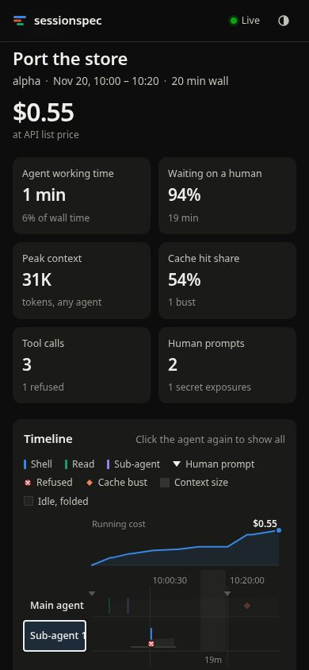
- embed-session 390x844 light, completion: 5 problem(s), run fails a gate. 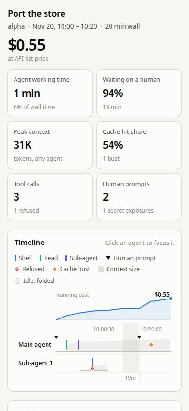
- failing-check 390x844 light, completion: 5 problem(s), run fails a gate. 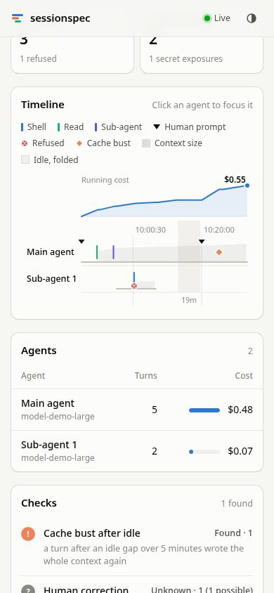
- agent-lane 1440x900 dark, completion: 3 problem(s), run fails a gate. 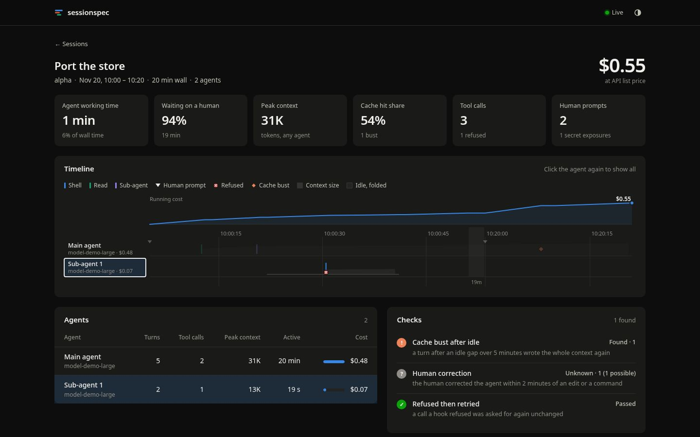
- agent-lane 1280x720 dark, completion: 3 problem(s), run fails a gate. 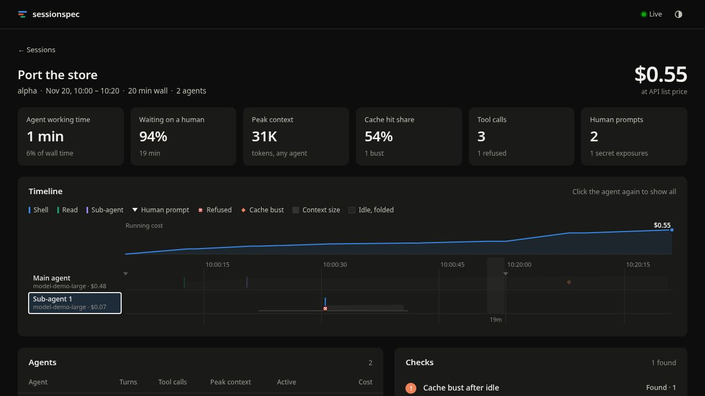
- embed-session 1440x900 light, completion: 3 problem(s), run fails a gate. 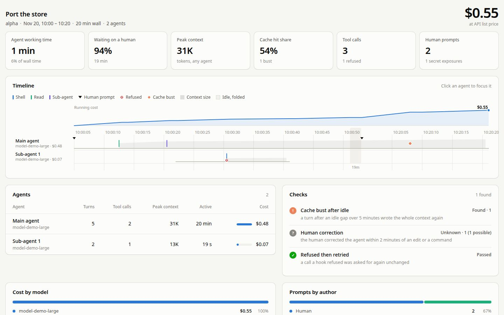

## Completion frames

- agent-lane 1440x900 dark: 
- agent-lane 1440x900 light: 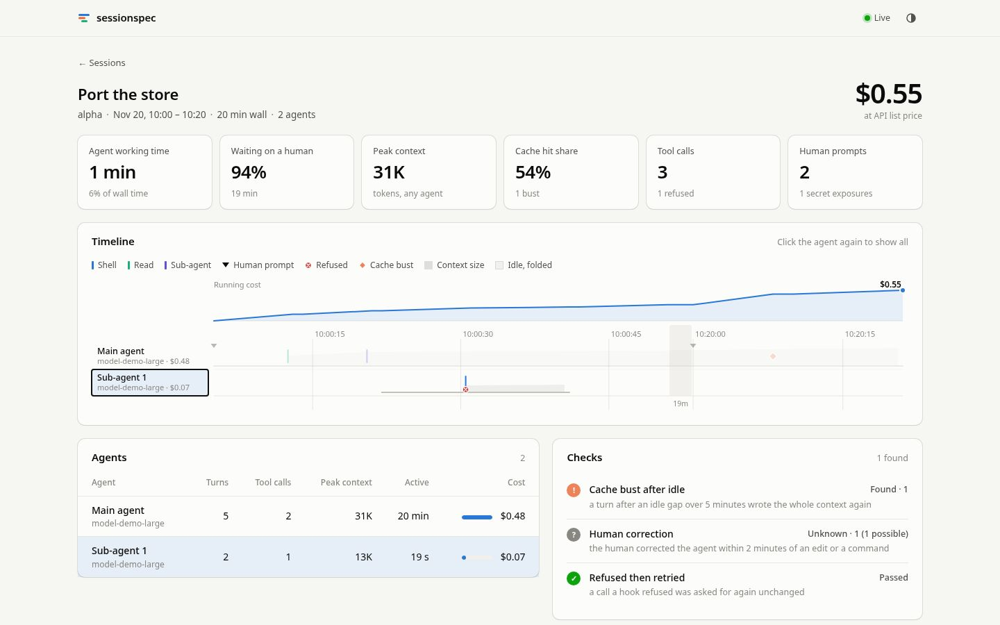
- embed-session 1440x900 dark: 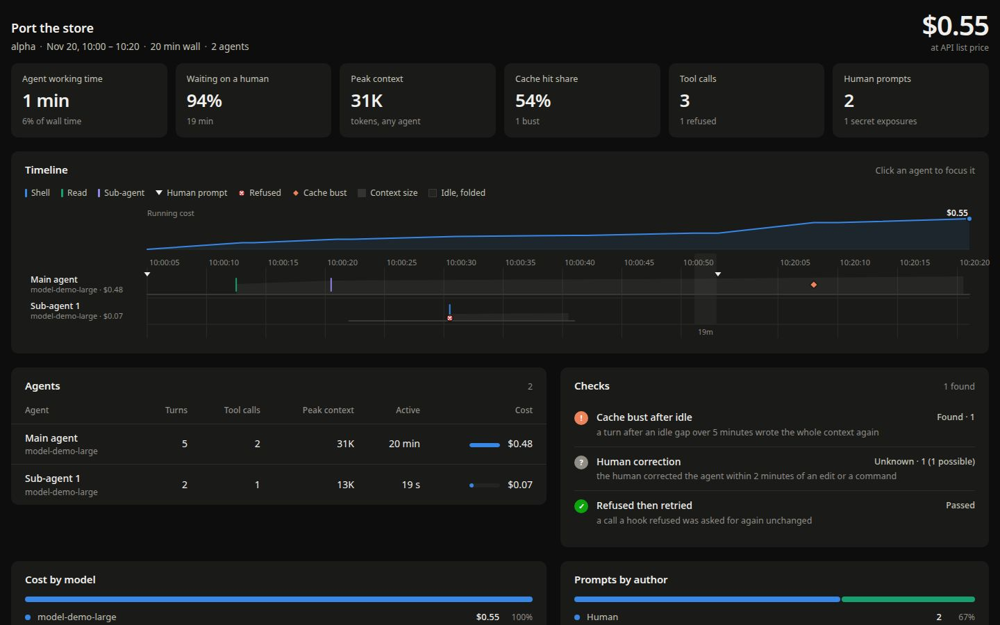
- embed-session 1440x900 light: 
- failing-check 1440x900 dark: 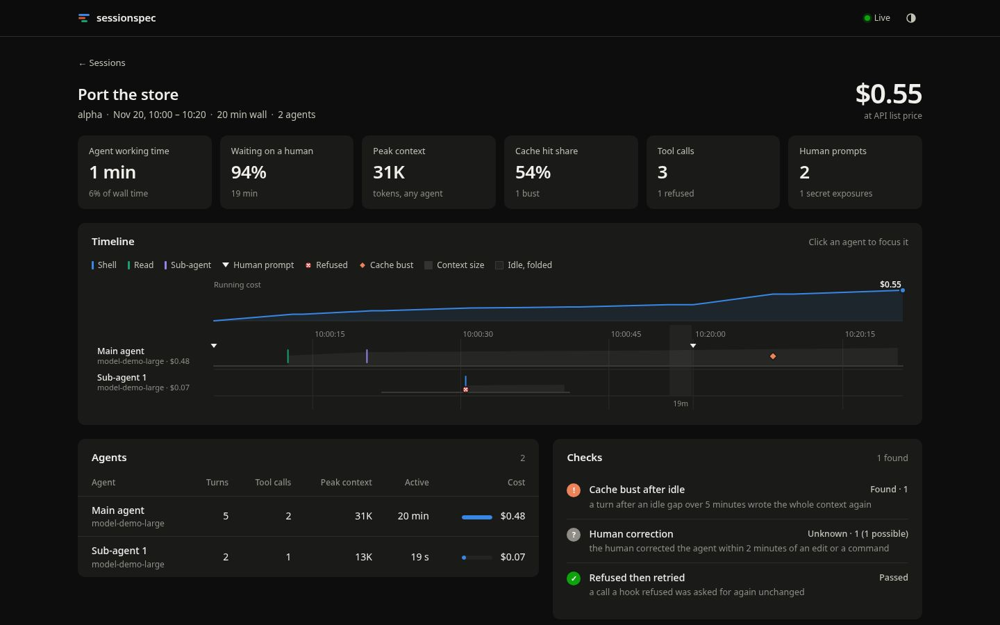
- failing-check 1440x900 light: 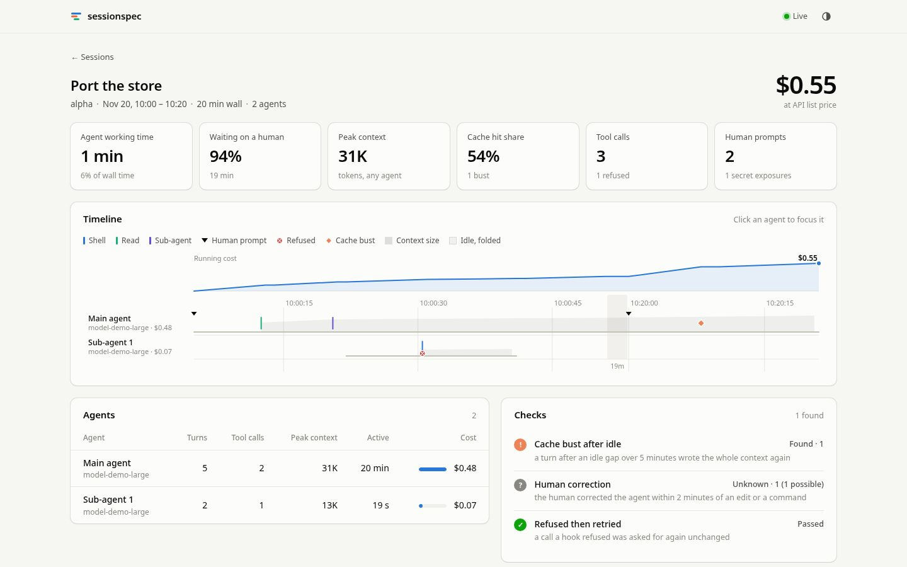
- find-session-by-search 1440x900 dark: 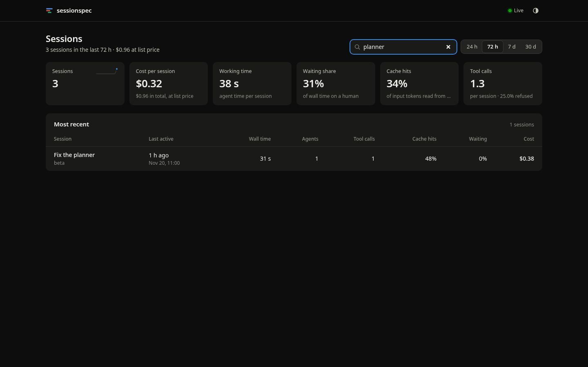
- find-session-by-search 1440x900 light: 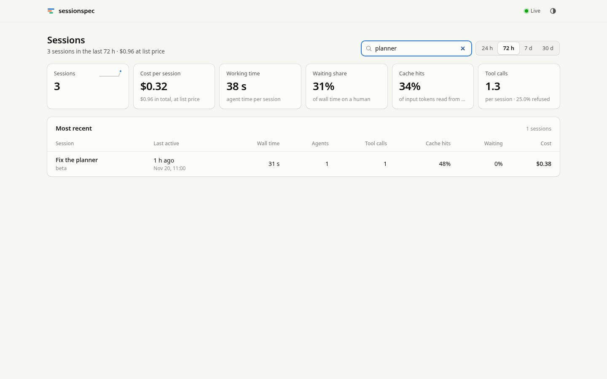
- slice-kpi-averages 1440x900 dark: 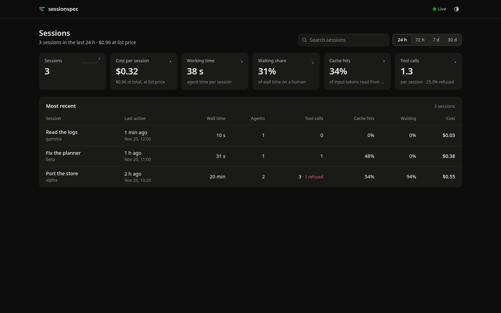
- slice-kpi-averages 1440x900 light: 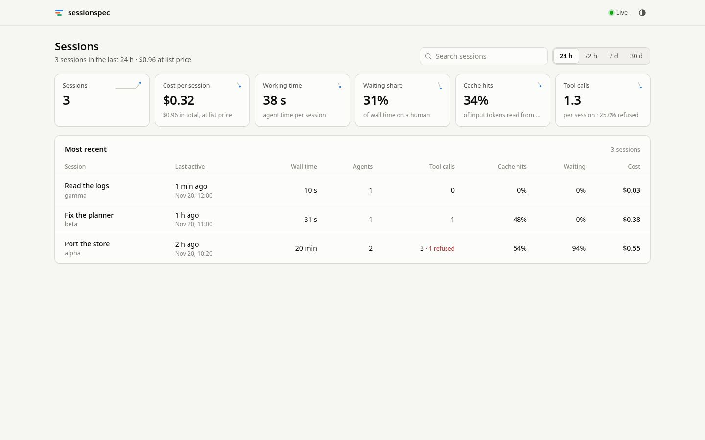

Contact sheets: 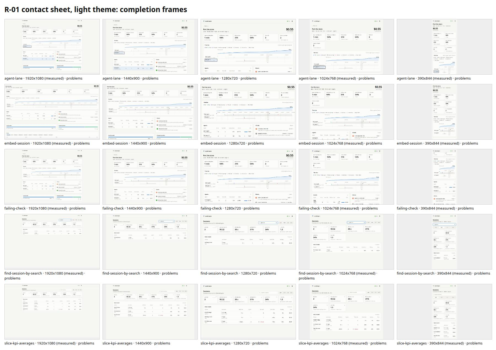 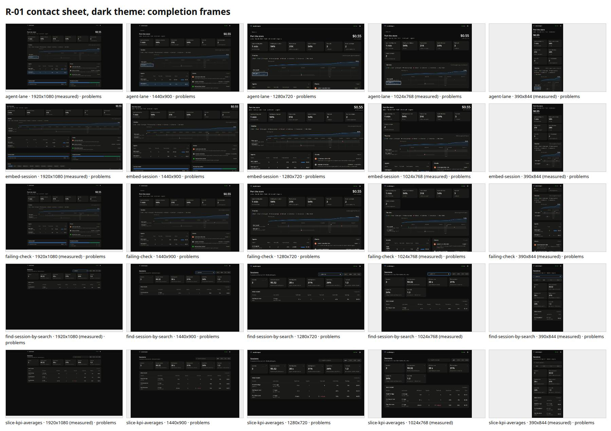

## Findings

none
