# R-02 report

Date 2026-11-26. App at commit 302e2fe with uncommitted changes in ui/ or ux/. Fixtures: ui/fixtures (synthetic). Written by ux/round.sh.

## Levels

- This report: L2 layout contract and axe-core at every moment, L3 screen-only user, on every scenario, viewport and theme.
- Outside it: L1 unit tests and the gates run in `task check:app`; L7, the two review agents, write review-heuristics.md and review-report.md after this report.
- Not run: L0 (the UI has no guidance cue), L4 and L5 (paid levels), L6 and L8 (people).
- So: no survey, no recordings of people, no probe misses. Each run's recording is its screenshots and the bot's log in round.json.

## Gates at the gating viewports

- 20 of 20 runs complete: the target in view and right.
- 20 of 20 runs are clean: no layout or axe problem at any moment.

| scenario | viewport | theme | completion | right | distinct problems |
|---|---|---|---|---|---|
| agent-lane | 1440x900 | dark | glance 1 | yes | 0 |
| agent-lane | 1440x900 | light | glance 1 | yes | 0 |
| agent-lane | 1280x720 | dark | glance 1 | yes | 0 |
| agent-lane | 1280x720 | light | glance 1 | yes | 0 |
| embed-session | 1440x900 | dark | glance 1 | yes | 0 |
| embed-session | 1440x900 | light | glance 1 | yes | 0 |
| embed-session | 1280x720 | dark | glance 1 | yes | 0 |
| embed-session | 1280x720 | light | glance 1 | yes | 0 |
| failing-check | 1440x900 | dark | glance 1 | yes | 0 |
| failing-check | 1440x900 | light | glance 1 | yes | 0 |
| failing-check | 1280x720 | dark | glance 1 | yes | 0 |
| failing-check | 1280x720 | light | glance 1 | yes | 0 |
| find-session-by-search | 1440x900 | dark | glance 1 | yes | 0 |
| find-session-by-search | 1440x900 | light | glance 1 | yes | 0 |
| find-session-by-search | 1280x720 | dark | glance 1 | yes | 0 |
| find-session-by-search | 1280x720 | light | glance 1 | yes | 0 |
| slice-kpi-averages | 1440x900 | dark | glance 1 | yes | 0 |
| slice-kpi-averages | 1440x900 | light | glance 1 | yes | 0 |
| slice-kpi-averages | 1280x720 | dark | glance 1 | yes | 0 |
| slice-kpi-averages | 1280x720 | light | glance 1 | yes | 0 |

## Measured-only viewports (not gated)

- 28 of 30 runs complete.
- 24 of 30 runs are clean.

| scenario | viewport | theme | completion | right | distinct problems |
|---|---|---|---|---|---|
| agent-lane | 1920x1080 | dark | glance 1 | yes | 0 |
| agent-lane | 1920x1080 | light | glance 1 | yes | 0 |
| agent-lane | 1024x768 | dark | glance 1 | yes | 0 |
| agent-lane | 1024x768 | light | glance 1 | yes | 0 |
| agent-lane | 390x844 | dark | glance 1 | no | 2 |
| agent-lane | 390x844 | light | glance 1 | no | 2 |
| embed-session | 1920x1080 | dark | glance 1 | yes | 0 |
| embed-session | 1920x1080 | light | glance 1 | yes | 0 |
| embed-session | 1024x768 | dark | glance 1 | yes | 0 |
| embed-session | 1024x768 | light | glance 1 | yes | 0 |
| embed-session | 390x844 | dark | glance 1 | yes | 2 |
| embed-session | 390x844 | light | glance 1 | yes | 2 |
| failing-check | 1920x1080 | dark | glance 1 | yes | 0 |
| failing-check | 1920x1080 | light | glance 1 | yes | 0 |
| failing-check | 1024x768 | dark | glance 1 | yes | 0 |
| failing-check | 1024x768 | light | glance 1 | yes | 0 |
| failing-check | 390x844 | dark | glance 1 | yes | 2 |
| failing-check | 390x844 | light | glance 1 | yes | 2 |
| find-session-by-search | 1920x1080 | dark | glance 1 | yes | 0 |
| find-session-by-search | 1920x1080 | light | glance 1 | yes | 0 |
| find-session-by-search | 1024x768 | dark | glance 1 | yes | 0 |
| find-session-by-search | 1024x768 | light | glance 1 | yes | 0 |
| find-session-by-search | 390x844 | dark | glance 1 | yes | 0 |
| find-session-by-search | 390x844 | light | glance 1 | yes | 0 |
| slice-kpi-averages | 1920x1080 | dark | glance 1 | yes | 0 |
| slice-kpi-averages | 1920x1080 | light | glance 1 | yes | 0 |
| slice-kpi-averages | 1024x768 | dark | glance 1 | yes | 0 |
| slice-kpi-averages | 1024x768 | light | glance 1 | yes | 0 |
| slice-kpi-averages | 390x844 | dark | glance 1 | yes | 0 |
| slice-kpi-averages | 390x844 | light | glance 1 | yes | 0 |

## Problems seen

- text cut off without its full value: td.what.bad "Refuse · Classifier" (2: 390x844 dark (measured), 390x844 light (measured))
- text cut off without its full value: td.what "by parent agent" (2: 390x844 dark (measured), 390x844 light (measured))

## Metrics, light theme (lower is better)

| scenario | screen_only.actions | screen_only.looks | screen_only.steers | screen_only.time_to_act_steps.max | glance_cost.median | glance_cost.p95 | reading_load.max | reading_load.median | layout_shift.score |
|---|---|---|---|---|---|---|---|---|---|
| agent-lane@1440x900 | 2 (base 2) | 3 (base 3) | 0 (base 0) | 1 (base 1) | 1 (base 1) | 1 (base 1) | 194 (base 194) | 193 (base 193) | 0.0001 (base 0.0001) |
| agent-lane@1280x720 | 2 (base 2) | 3 (base 3) | 0 (base 0) | 1 (base 1) | 1 (base 1) | 1 (base 1) | 139 (base 139) | 139 (base 139) | 0.0002 (base 0.0002) |
| embed-session@1440x900 | 0 (base 0) | 1 (base 1) | 0 (base 0) | 0 (base 0) | 1 (base 1) | 1 (base 1) | 210 (base 210) | 210 (base 210) | 0 (base 0) (R-01 0.1435) |
| embed-session@1280x720 | 0 (base 0) | 1 (base 1) | 0 (base 0) | 0 (base 0) | 1 (base 1) | 1 (base 1) | 187 (base 187) | 187 (base 187) | 0 (base 0) (R-01 0.1098) |
| failing-check@1440x900 | 1 (base 1) | 2 (base 2) | 0 (base 0) | 1 (base 1) | 1 (base 1) | 1 (base 1) | 193 (base 193) | 166 (base 166) | 0.0001 (base 0.0001) |
| failing-check@1280x720 | 2 (base 2) | 3 (base 3) | 0 (base 0) | 1 (base 1) | 1 (base 1) | 2 (base 2) | 155 (base 155) | 139 (base 139) | 0.0002 (base 0.0002) |
| find-session-by-search@1440x900 | 2 (base 2) | 2 (base 2) | 0 (base 0) | 1 (base 1) | 1 (base 1) | 1 (base 1) | 139 (base 139) | 120.5 (base 120.5) | 0.0047 (base 0.0047) |
| find-session-by-search@1280x720 | 2 (base 2) | 2 (base 2) | 0 (base 0) | 1 (base 1) | 1 (base 1) | 1 (base 1) | 139 (base 139) | 120.5 (base 120.5) | 0.0074 (base 0.0074) |
| slice-kpi-averages@1440x900 | 1 (base 1) | 2 (base 2) | 0 (base 0) | 1 (base 1) | 1 (base 1) | 1 (base 1) | 139 (base 139) | 139 (base 139) | 0.0001 (base 0.0001) |
| slice-kpi-averages@1280x720 | 1 (base 1) | 2 (base 2) | 0 (base 0) | 1 (base 1) | 1 (base 1) | 1 (base 1) | 139 (base 139) | 139 (base 139) | 0.0002 (base 0.0002) |

## Worst moments

- agent-lane 390x844 dark, completion: 2 problem(s), the run does not complete (measured only). 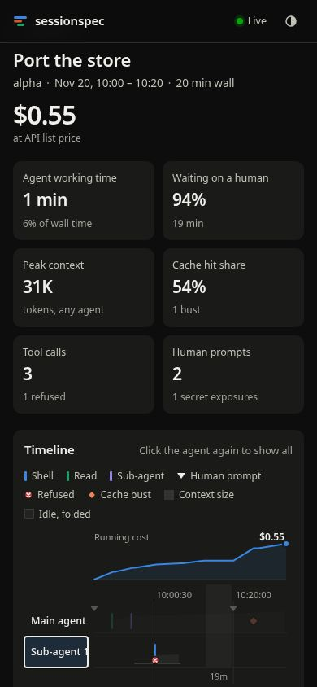
- embed-session 390x844 dark, start: 2 problem(s) (measured only). 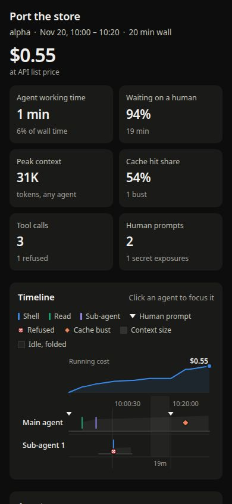
- failing-check 390x844 dark, after the row of Port the store: 2 problem(s) (measured only). 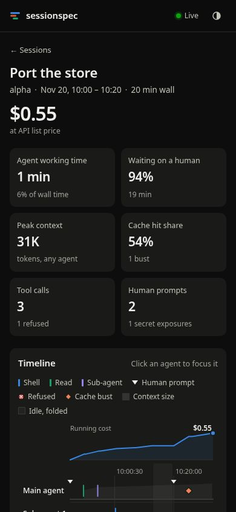

## Completion frames

- agent-lane 1440x900 dark: 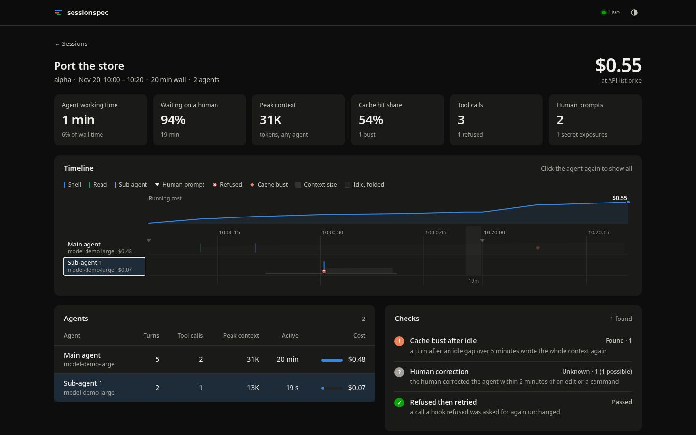
- agent-lane 1440x900 light: 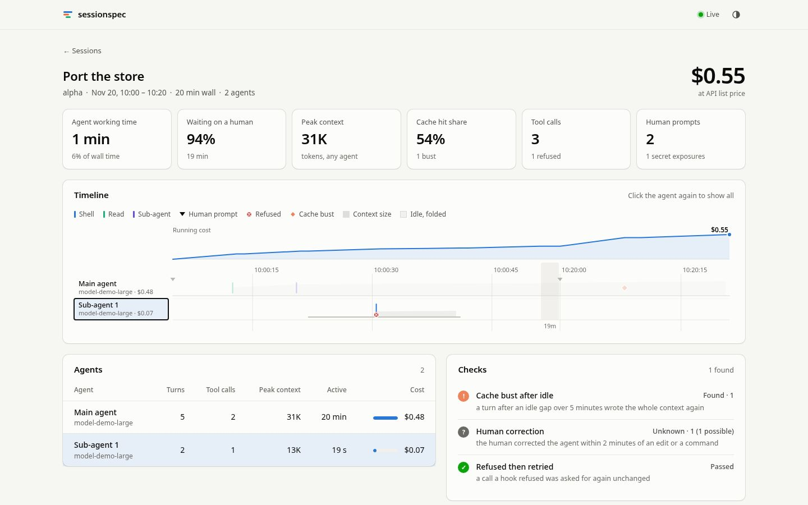
- embed-session 1440x900 dark: 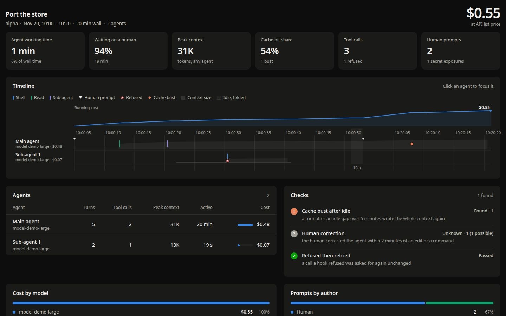
- embed-session 1440x900 light: 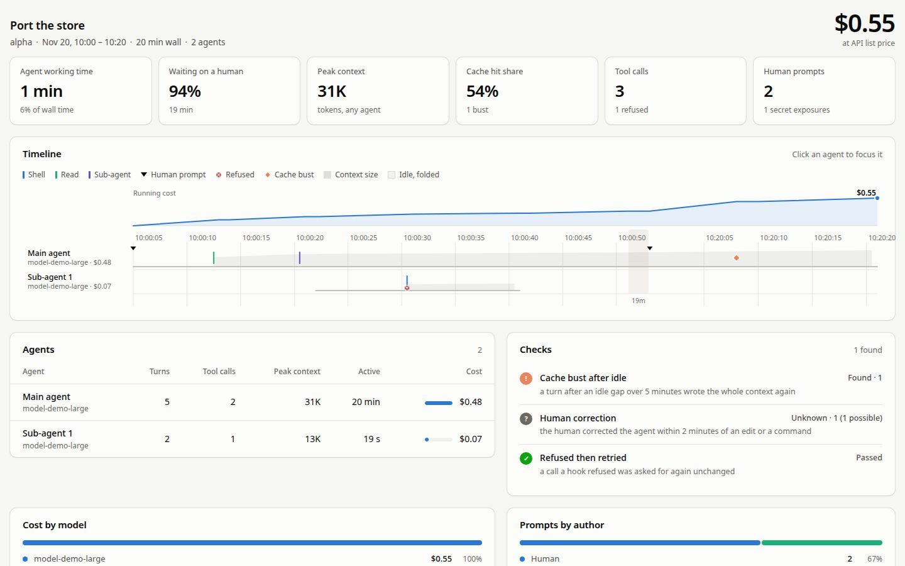
- failing-check 1440x900 dark: 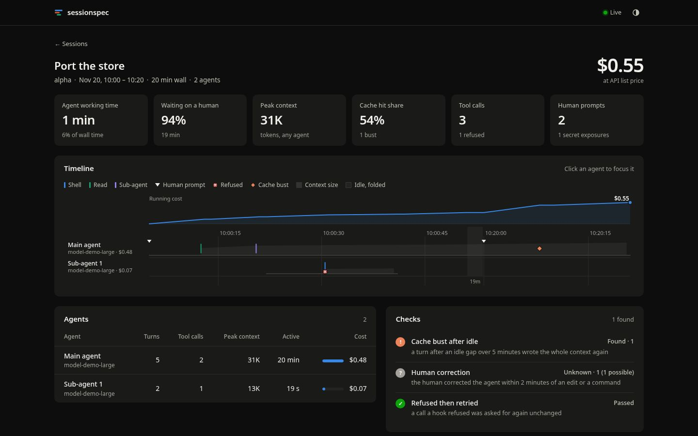
- failing-check 1440x900 light: 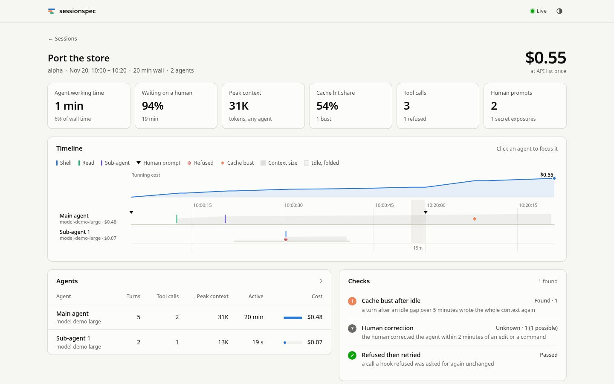
- find-session-by-search 1440x900 dark: 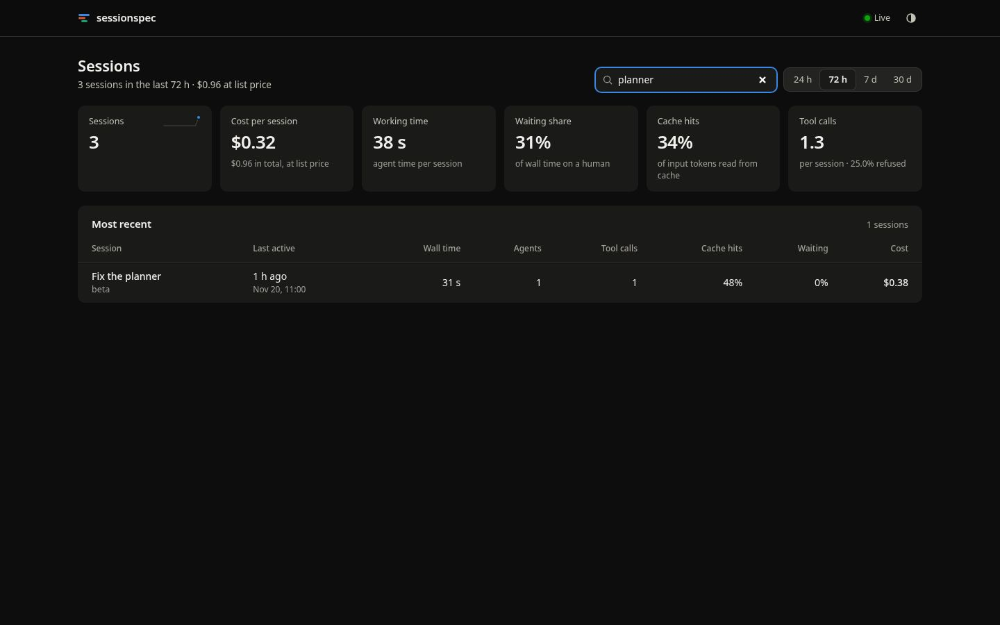
- find-session-by-search 1440x900 light: 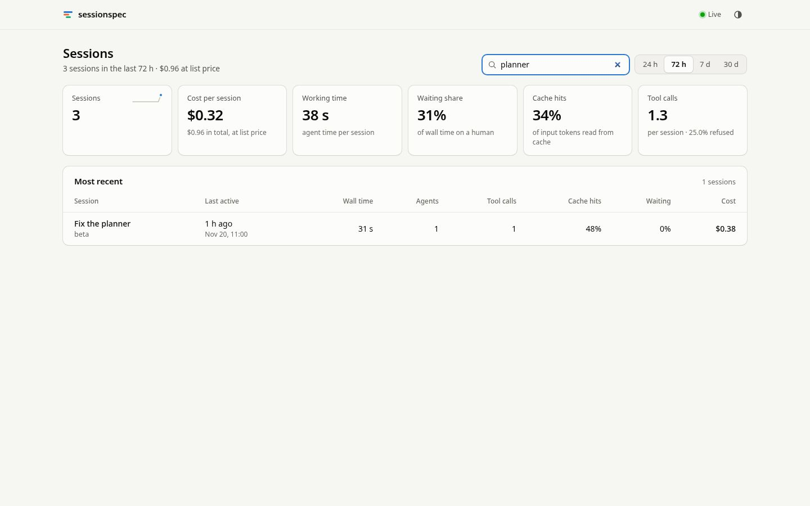
- slice-kpi-averages 1440x900 dark: 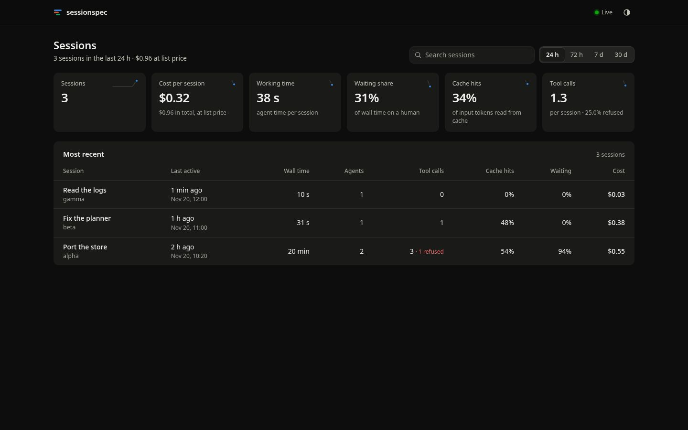
- slice-kpi-averages 1440x900 light: 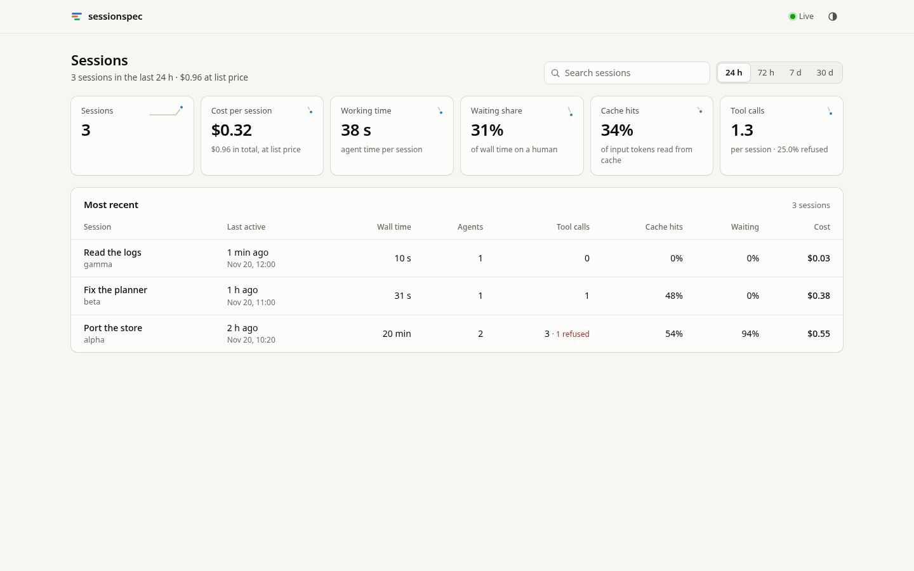

Contact sheets: 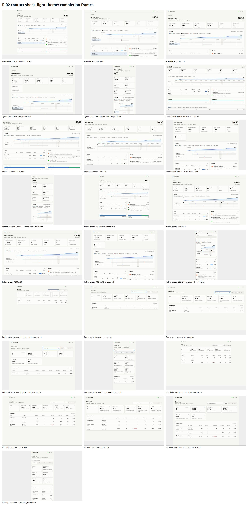 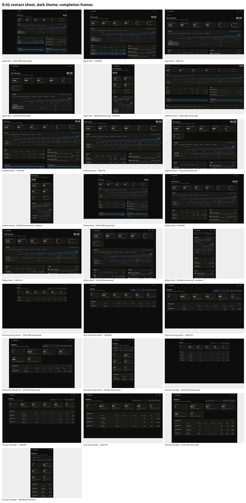

## Findings

As of this report; the review agents file theirs after it.

- UXF-001 S1 closed: The event filter chips carry aria-pressed on role radio
- UXF-002 S2 closed: The timeline is an image that holds buttons
- UXF-003 S2 closed: Muted notes fall below 4.5:1 contrast
- UXF-004 S2 closed: A tile note is cut off with no way to read it whole
- UXF-005 S2 closed: The embed page jumps while it loads
- UXF-006 S2 open: With a search, the figures and the heading still count every session in the slice
- UXF-007 S2 open: The lane label hides its cost on a narrow screen and prints it at 11 px elsewhere
- UXF-008 S3 open: The timeline answers the pointer only; Space on a lane scrolls the page away
- UXF-009 S3 open: One figure has two names across the pages, and some labels are raw or wrongly plural
- UXF-010 S2 open: Back to the list forgets the search
